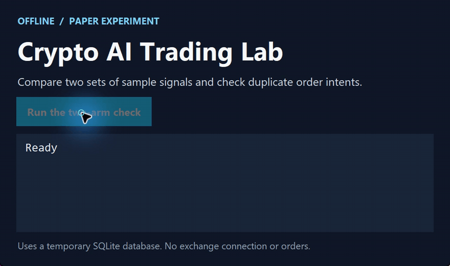

# Crypto AI Trading Lab

[简体中文](https://github.com/chenbinghan666/crypto-ai-trading-lab/blob/main/README.md) · **English** · [日本語](https://github.com/chenbinghan666/crypto-ai-trading-lab/blob/main/docs/locales/README.ja.md) · [Deutsch](https://github.com/chenbinghan666/crypto-ai-trading-lab/blob/main/docs/locales/README.de.md) · [Français](https://github.com/chenbinghan666/crypto-ai-trading-lab/blob/main/docs/locales/README.fr.md) · [Español](https://github.com/chenbinghan666/crypto-ai-trading-lab/blob/main/docs/locales/README.es.md) · [Português](https://github.com/chenbinghan666/crypto-ai-trading-lab/blob/main/docs/locales/README.pt.md)

A Chinese-language workbench for backtesting, FreqAI experiments, and futures simulation. Compare rule-based and model-based strategies with separate virtual ledgers. The current scope is research and simulation.

Python · Freqtrade · FreqAI

An independent cryptocurrency research and contract simulation system that provides Chinese web management pages and integrates Freqtrade / FreqUI, FreqAI CPU LightGBM and TradingAgents / DeepSeek. The runtime does not rely on Codex or chat sessions.

**The project supports research and paper trading only. The strategies and models have no demonstrated profitability.**

## Demo

Uses sample signals and a temporary database to show both experiment arms and duplicate intent handling.

[](../../docs/images/project-demo.mp4)

[Download MP4](../../docs/images/project-demo.mp4?raw=true)

## Features

- Binance public quotes, connection diagnosis, K-line and refresh countdown; Gate permanent public quotes are used for independent contract simulation.
- Binance U-based contract accounts are read-only bound to query assets and positions; API configurations are encrypted and saved locally.
- TradingAgents / DeepSeek research tasks, API usage accounting, budget reservations and fee limits.
- FreqAI CPU training, time-isolated evaluation, model saving and reload validation.
- Official Freqtrade contract backtesting and real-time dry-run: long and short positions, opening and closing orders, transaction status and profit and loss.
- Automatic optimization: Generate candidates, train, and cost out-of-sample comparisons, switch simulation versions through post-short positions, and roll back when performance deteriorates.
- 15m AI control experiment: The rule group and the FreqAI model group use independent virtual ledgers to compare signals, transaction records, and profits and losses.
- Independent process daemon, disconnection reconnection, state recovery, order deduplication, Windows one-click start and stop, and Docker Compose configuration.

## Run on Windows

For environment preparation and dependency installation, see [Windows installation](../../docs/INSTALL_WINDOWS.md) and [deployment instructions](../../docs/DEPLOYMENT.md). Requires WSL/Ubuntu and a compatible Python environment; Windows scripts will discover the project path.

1. Clone the repository and prepare WSL and dependencies according to the installation documentation.
2. Double-click `启动系统.cmd` to access <http://127.0.0.1:8080>.
3. Double-click `FreqUI登录信息.cmd` to view the local management password and unlock the panel on the web page.
4. Configure the required APIs on the web, check prices and services, and manually enable research, training or simulation.
5. Double-click `停止系统.cmd` to stop the service, and `查看状态.cmd` to view the running status.

Closing the browser or development tools will not affect background services; shutting down or hibernating the computer will interrupt local operations. New deployments do not start simulation and automatic optimization by default. The warehouse does not contain the developer's configuration, keys, models and running data, and needs to be initialized by itself after cloning.

Official research FreqUI: <http://127.0.0.1:8081>. Read-only FreqUI after original 1h simulation start: <http://127.0.0.1:8083>.

## Docker Compose

```sh
docker compose up -d --build
docker compose down
```

The default port is only bound to the local machine. For the first deployment, you need to configure the credentials and module switches yourself. The main program and research service image configurations have been provided; the actual Docker build and Linux VPS deployment still need to be accepted in the target environment.

## The boundary between simulation and AI

Simulate the use of virtual funds without exchange trading permissions. The current leverage is fixed at 1x, and independent position, daily loss, drawdown and consecutive loss cooling limits are retained. The strategy is evaluated based on the closing K-line. Zero trading is allowed when there is no signal or risk control has not been released.

The AI in the 15m controlled experiment refers to the local FreqAI LightGBM prediction filtering; TradingAgents / DeepSeek is a separate research and optimization process. The experimental model has not been accepted for profit, and the experimental results will not directly replace the original account strategy. Automatic optimization only adjusts restricted parameters and models and does not execute arbitrary code generated by AI.

Please refer to the relevant documents for handling fees, slippage fee conversion, capital fees, training data isolation and final inspection rules. Cost conversion cannot fully represent the real transaction impact, and short-term simulated returns cannot prove the effectiveness of the strategy.

## Credentials and operational data

Only fill in the API key on the local web page, do not submit it to GitHub, Issue or chat. Use read-only Binance account permissions; transactions will not be executed with this account. DeepSeek calls are subject to budget and price verification validity.

Native environment files, keys, databases, models, logs, run reports, and screenshots are excluded by `.gitignore`. The public repository only contains source code, configuration templates, tests, and documentation. Reports generated after running the program remain on the local machine.

## Documentation

- [Deployment and Fault Recovery](../../docs/DEPLOYMENT.md) · [Recovery Guide](../../docs/RECOVERY.md)
- [web page operation](../../docs/WEB_CONTROLS.md) · [account read-only binding](../../docs/BINANCE_ACCOUNT.md)
- [contract simulation](../../docs/PAPER_TRADING.md) · [15m AI control experiment](../../docs/FAST_AI_EXPERIMENT.md)
- [FreqAI CPU](../../docs/FREQAI_CPU.md) · [AI Research](../../docs/AI_RESEARCH.md)
- [automatically optimizes](../../docs/AUTOMATIC_OPTIMIZATION.md) · [risk policy](../../docs/RISK_POLICY.md)
- [independent operation acceptance](../../docs/INDEPENDENCE_ACCEPTANCE.md)

## Development verification

```powershell
.\scripts\lab.ps1 test
```

You need to install the running dependencies specified in the document first. The network acceptance, independent background recovery and experimental service acceptance scripts are located at `scripts/`; some scripts require that local services have been started. The acceptance output is not released with the warehouse.

The upstreams used by the project include [Freqtrade](https://github.com/freqtrade/freqtrade) and [TradingAgents](https://github.com/TauricResearch/TradingAgents). Dependency versions are fixed in the requirements lock file, and upstream software follows their respective licenses.
