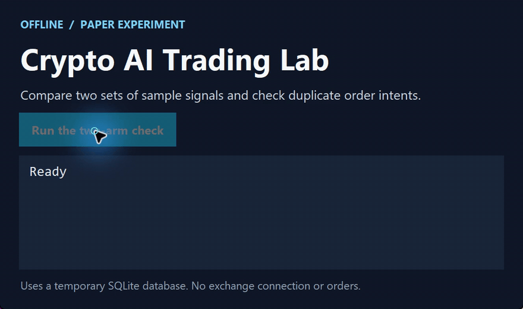

# Crypto AI Trading Lab

[简体中文](https://github.com/chenbinghan666/crypto-ai-trading-lab/blob/main/README.md) · [English](https://github.com/chenbinghan666/crypto-ai-trading-lab/blob/main/docs/locales/README.en.md) · [日本語](https://github.com/chenbinghan666/crypto-ai-trading-lab/blob/main/docs/locales/README.ja.md) · [Deutsch](https://github.com/chenbinghan666/crypto-ai-trading-lab/blob/main/docs/locales/README.de.md) · **Français** · [Español](https://github.com/chenbinghan666/crypto-ai-trading-lab/blob/main/docs/locales/README.es.md) · [Português](https://github.com/chenbinghan666/crypto-ai-trading-lab/blob/main/docs/locales/README.pt.md)

Un espace de travail en chinois pour le backtesting, les expériences FreqAI et la simulation de contrats à terme. Des comptes virtuels distincts permettent de comparer des stratégies à règles et des stratégies fondées sur un modèle. Le projet est dédié à la recherche et à la simulation.

Python · Freqtrade · FreqAI

Un système indépendant de recherche et de simulation de contrats de crypto-monnaie qui fournit des pages de gestion Web chinoises et intègre Freqtrade/FreqUI, FreqAI CPU LightGBM et TradingAgents/DeepSeek. Le runtime ne repose pas sur le Codex ou les sessions de chat.

**ne prend actuellement en charge que la recherche et le trading virtuel, le trading réel étant interdit. Ni les stratégies ni les modèles ne représentent une rentabilité prouvée.**

## Démonstration

Utilise des signaux d’exemple et une base temporaire pour comparer les deux groupes et vérifier le rejet des instructions en double.

[](../../docs/images/project-demo.mp4)

[Télécharger le MP4](../../docs/images/project-demo.mp4?raw=true)

## Fonction

- Cotations publiques Binance, diagnostic de connexion, compte à rebours K-line et rafraîchissement ; Les devis publics permanents de Gate sont utilisés pour la simulation de contrats indépendants.
- Les comptes contractuels basés sur Binance U sont liés en lecture seule pour interroger les actifs et les positions ; Les configurations API sont cryptées et enregistrées localement.
- Tâches de recherche TradingAgents / DeepSeek, comptabilité de l'utilisation des API, réservations budgétaires et limites de frais.
- Formation CPU FreqAI, évaluation isolée dans le temps, sauvegarde du modèle et validation du rechargement.
- Backtesting officiel des contrats Freqtrade et simulation en temps réel : positions longues et courtes, ordres d'ouverture et de clôture, statut de la transaction et profits et pertes.
- Optimisation automatique : générez des candidats, entraînez-vous et comparez les coûts hors échantillon, changez de version de simulation via des positions post-short et revenez en arrière lorsque les performances se détériorent.
- Expérience de contrôle de l'IA de 15 millions : le groupe de règles et le groupe de modèles FreqAI utilisent des registres virtuels indépendants pour comparer les signaux, les enregistrements de transactions ainsi que les profits et les pertes.
- Démon de processus indépendant, reconnexion par déconnexion, récupération d'état, déduplication des commandes, démarrage et arrêt de Windows en un clic et configuration de Docker Compose.

## Windows démarre

Pour la préparation de l'environnement et l'installation des dépendances, consultez les instructions d'installation de [Windows](../../docs/INSTALL_WINDOWS.md) et de déploiement [](../../docs/DEPLOYMENT.md). Nécessite WSL/Ubuntu et un environnement Python compatible ; Les scripts Windows découvriront le chemin du projet.

1. Clonez le référentiel et préparez WSL et les dépendances conformément à la documentation d'installation.
2. Double-cliquez sur `启动系统.cmd` pour accéder à <http://127.0.0.1:8080>.
3. Double-cliquez sur `FreqUI登录信息.cmd` pour afficher le mot de passe de gestion local et déverrouiller le panneau sur la page Web.
4. Configurez les API requises sur le Web, vérifiez les prix et les services, et activez manuellement la recherche, la formation ou la simulation.
5. Double-cliquez sur `停止系统.cmd` pour arrêter le service et sur `查看状态.cmd` pour afficher l'état d'exécution.

La fermeture du navigateur ou des outils de développement n'affectera pas les services d'arrière-plan ; l'arrêt ou la mise en veille prolongée de l'ordinateur interrompra les opérations locales. Les nouveaux déploiements ne démarrent pas la simulation et l'optimisation automatique par défaut. L'entrepôt ne contient pas la configuration, les clés, les modèles et les données d'exécution du développeur, et doit être initialisé par lui-même après le clonage.

Recherche officielle FreqUI : <http://127.0.0.1:8081>. FreqUI en lecture seule après le démarrage de la simulation d'origine d'une heure : <http://127.0.0.1:8083>.

## Docker Compose

```sh
docker compose up -d --build
docker compose down
```

Le port par défaut est uniquement lié à la machine locale. Pour le premier déploiement, vous devez configurer vous-même les informations d'identification et les commutateurs de modules. Les principales configurations des images du programme et du service de recherche ont été fournies ; la version réelle de Docker et le déploiement de Linux VPS doivent encore être acceptés dans l'environnement cible.

## La frontière entre simulation et IA

Simulez l'utilisation de fonds virtuels sans autorisations de trading en bourse. L'effet de levier actuel est fixé à 1x et les limites de position indépendante, de perte quotidienne, de prélèvement et de refroidissement des pertes consécutives sont conservées. La stratégie est évaluée sur la base de la ligne K de clôture. Le zéro trading est autorisé lorsqu’il n’y a aucun signal ou que le contrôle des risques n’a pas été libéré.

L'IA dans l'expérience contrôlée de 15 m fait référence au filtrage de prédiction local FreqAI LightGBM ; TradingAgents / DeepSeek est un processus de recherche et d'optimisation distinct. Le modèle expérimental n'a pas été accepté à des fins lucratives et les résultats expérimentaux ne remplaceront pas directement la stratégie de compte d'origine. L'optimisation automatique ajuste uniquement les paramètres et modèles restreints et n'exécute pas de code arbitraire généré par l'IA.

Veuillez vous référer aux documents pertinents pour les frais de traitement, la conversion des frais de glissement, les frais de capital, l'isolement des données de formation et les règles d'inspection finale. La conversion des coûts ne peut pas représenter pleinement l’impact réel de la transaction, et les rendements simulés à court terme ne peuvent pas prouver l’efficacité de la stratégie.

## Identifiants et données opérationnelles

Remplissez uniquement la clé API sur la page Web locale, ne la soumettez pas à GitHub, Issue ou chat. Utilisez les autorisations du compte Binance en lecture seule ; aucune transaction ne sera exécutée avec ce compte. Les appels DeepSeek sont soumis à la validité de la vérification du budget et du prix.

Les fichiers d'environnement natifs, les clés, les bases de données, les modèles, les journaux, les rapports d'exécution et les captures d'écran sont exclus par `.gitignore`. Le référentiel public contient uniquement le code source, les modèles de configuration, les tests et la documentation. Les rapports générés après l'exécution du programme restent sur la machine locale.

## Documentation

- Déploiement et récupération des pannes du [](../../docs/DEPLOYMENT.md) · Guide de récupération du [](../../docs/RECOVERY.md)
- Fonctionnement de la page Web [](../../docs/WEB_CONTROLS.md) · Liaison en lecture seule du compte [](../../docs/BINANCE_ACCOUNT.md)
- Simulation de contrat [](../../docs/PAPER_TRADING.md) · Expérience de contrôle IA [15m](../../docs/FAST_AI_EXPERIMENT.md)
- Processeur [FreqAI](../../docs/FREQAI_CPU.md) · Recherche [AI](../../docs/AI_RESEARCH.md)
- [optimise automatiquement](../../docs/AUTOMATIC_OPTIMIZATION.md) · Politique de risque [](../../docs/RISK_POLICY.md)
- Acceptation de fonctionnement indépendante [](../../docs/INDEPENDENCE_ACCEPTANCE.md)

## Vérification du développement

```powershell
.\scripts\lab.ps1 test
```

Vous devez d'abord installer les dépendances en cours d'exécution spécifiées dans le document. Les scripts d'acceptation du réseau, de récupération en arrière-plan indépendante et d'acceptation de service expérimental se trouvent sur `scripts/` ; certains scripts nécessitent que les services locaux aient été démarrés. La sortie d'acceptation n'est pas validée auprès du magasin.

Les amonts utilisés par le projet incluent [Freqtrade](https://github.com/freqtrade/freqtrade) et [TradingAgents](https://github.com/TauricResearch/TradingAgents). Les versions de dépendance sont corrigées dans le fichier de verrouillage des exigences et les logiciels en amont suivent leurs licences respectives.
