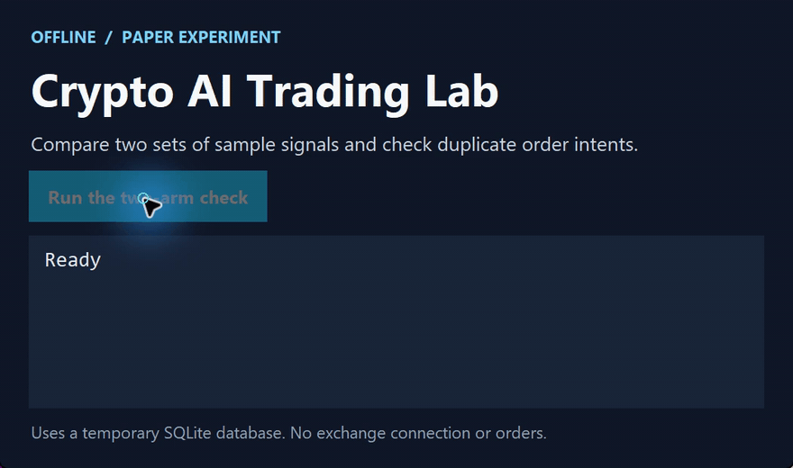

# Crypto AI Trading Lab

[简体中文](https://github.com/chenbinghan666/crypto-ai-trading-lab/blob/main/README.md) · [English](https://github.com/chenbinghan666/crypto-ai-trading-lab/blob/main/docs/locales/README.en.md) · [日本語](https://github.com/chenbinghan666/crypto-ai-trading-lab/blob/main/docs/locales/README.ja.md) · [Deutsch](https://github.com/chenbinghan666/crypto-ai-trading-lab/blob/main/docs/locales/README.de.md) · [Français](https://github.com/chenbinghan666/crypto-ai-trading-lab/blob/main/docs/locales/README.fr.md) · [Español](https://github.com/chenbinghan666/crypto-ai-trading-lab/blob/main/docs/locales/README.es.md) · **Português**

Um ambiente em chinês para backtesting, experimentos com FreqAI e simulação de futuros. Contas virtuais separadas permitem comparar estratégias baseadas em regras e em modelos. O escopo é pesquisa e simulação.

Python · Freqtrade · FreqAI

Um sistema independente de pesquisa de criptomoedas e simulação de contratos que fornece páginas de gerenciamento da web chinesas e integra Freqtrade / FreqUI, FreqAI CPU LightGBM e TradingAgents / DeepSeek. O tempo de execução não depende do Codex ou de sessões de chat.

**atualmente suporta apenas pesquisa e negociação virtual, a negociação real é proibida. Nem estratégias nem modelos representam rentabilidade comprovada.**

## Demonstração

Usa sinais de exemplo e um banco temporário para mostrar os dois grupos e verificar o bloqueio de instruções duplicadas.

[](../../docs/images/project-demo.mp4)

[Baixar MP4](../../docs/images/project-demo.mp4?raw=true)

## Função

- Cotações públicas da Binance, diagnóstico de conexão, linha K e contagem regressiva de atualização; As cotações públicas permanentes da Gate são usadas para simulação de contratos independentes.
- As contas de contrato baseadas na Binance U são vinculadas somente leitura para consultar ativos e posições; As configurações da API são criptografadas e salvas localmente.
- Tarefas de pesquisa TradingAgents/DeepSeek, contabilidade de uso de API, reservas de orçamento e limites de taxas.
- Treinamento de CPU FreqAI, avaliação isolada no tempo, salvamento de modelo e validação de recarga.
- Backtesting oficial do contrato Freqtrade e simulação em tempo real: posições longas e curtas, ordens de abertura e fechamento, status da transação e lucros e perdas.
- Otimização automática: gere candidatos, treine e compare custos fora da amostra, alterne versões de simulação por meio de posições pós-venda e reverta quando o desempenho se deteriorar.
- Experimento de controle de IA de 15m: O grupo de regras e o grupo de modelos FreqAI usam livros virtuais independentes para comparar sinais, registros de transações e lucros e perdas.
- Daemon de processo independente, reconexão de desconexão, recuperação de estado, desduplicação de pedidos, inicialização e parada com um clique do Windows e configuração do Docker Compose.

## O Windows inicia

Para preparação do ambiente e instalação de dependência, consulte [Instalação do Windows](../../docs/INSTALL_WINDOWS.md) e instruções de implantação do [](../../docs/DEPLOYMENT.md). Requer WSL/Ubuntu e um ambiente Python compatível; Os scripts do Windows descobrirão o caminho do projeto.

1. Clone o repositório e prepare WSL e dependências de acordo com a documentação de instalação.
2. Clique duas vezes em `启动系统.cmd` para acessar <http://127.0.0.1:8080>.
3. Clique duas vezes em `FreqUI登录信息.cmd` para visualizar a senha de gerenciamento local e desbloquear o painel na página da web.
4. Configure as APIs necessárias na web, verifique preços e serviços e ative manualmente pesquisas, treinamentos ou simulações.
5. Clique duas vezes em `停止系统.cmd` para interromper o serviço e em `查看状态.cmd` para visualizar o status de execução.

Fechar o navegador ou as ferramentas de desenvolvimento não afetará os serviços em segundo plano; desligar ou hibernar o computador interromperá as operações locais. Novas implantações não iniciam simulação e otimização automática por padrão. O warehouse não contém a configuração, chaves, modelos e dados em execução do desenvolvedor e precisa ser inicializado sozinho após a clonagem.

Pesquisa oficial FreqUI: <http://127.0.0.1:8081>. FreqUI somente leitura após o início da simulação original de 1h: <http://127.0.0.1:8083>.

## Docker Compose

```sh
docker compose up -d --build
docker compose down
```

A porta padrão está vinculada apenas à máquina local. Para a primeira implantação, você mesmo precisa configurar as credenciais e as opções de módulo. Foram fornecidas as principais configurações de imagens do programa e do serviço de pesquisa; a construção real do Docker e a implantação do Linux VPS ainda precisam ser aceitas no ambiente de destino.

## A fronteira entre simulação e IA

Simule o uso de fundos virtuais sem permissões de negociação em bolsa. A alavancagem atual é fixada em 1x, e os limites de posição independente, perda diária, rebaixamento e resfriamento de perdas consecutivas são mantidos. A estratégia é avaliada com base no fechamento da linha K. A negociação zero é permitida quando não há sinal ou o controle de risco não foi liberado.

A IA no experimento controlado de 15m refere-se à filtragem de previsão local FreqAI LightGBM; TradingAgents/DeepSeek é um processo separado de pesquisa e otimização. O modelo experimental não foi aceito para fins lucrativos e os resultados experimentais não substituirão diretamente a estratégia de conta original. A otimização automática ajusta apenas parâmetros e modelos restritos e não executa código arbitrário gerado pela IA.

Consulte os documentos relevantes para taxas de manuseio, conversão de taxas de deslizamento, taxas de capital, isolamento de dados de treinamento e regras de inspeção final. A conversão de custos não pode representar totalmente o impacto real da transação e os retornos simulados de curto prazo não podem provar a eficácia da estratégia.

## Credenciais e dados operacionais

Preencha apenas a chave API na página da web local, não a envie para GitHub, Issue ou chat. Use permissões de conta Binance somente leitura; as transações não serão executadas com esta conta. As chamadas DeepSeek estão sujeitas à validade de verificação de orçamento e preço.

Arquivos de ambiente nativo, chaves, bancos de dados, modelos, logs, relatórios de execução e capturas de tela são excluídos por `.gitignore`. O repositório público contém apenas código-fonte, modelos de configuração, testes e documentação. Os relatórios gerados após a execução do programa permanecem na máquina local.

## Documentação

- Implantação e recuperação de falhas [](../../docs/DEPLOYMENT.md) · Guia de recuperação [](../../docs/RECOVERY.md)
- Operação da página da web [](../../docs/WEB_CONTROLS.md) · Ligação somente leitura da conta [](../../docs/BINANCE_ACCOUNT.md)
- Simulação de contrato [](../../docs/PAPER_TRADING.md) · [15m Experimento de controle de IA](../../docs/FAST_AI_EXPERIMENT.md)
- CPU [FreqAI](../../docs/FREQAI_CPU.md) · Pesquisa [AI](../../docs/AI_RESEARCH.md)
- [otimiza automaticamente](../../docs/AUTOMATIC_OPTIMIZATION.md) · Política de risco [](../../docs/RISK_POLICY.md)
- [aceitação de operação independente](../../docs/INDEPENDENCE_ACCEPTANCE.md)

## Verificação de desenvolvimento

```powershell
.\scripts\lab.ps1 test
```

Você precisa primeiro instalar as dependências em execução especificadas no documento. Os scripts de aceitação de rede, recuperação independente de segundo plano e aceitação de serviço experimental estão localizados em `scripts/`; alguns scripts exigem que os serviços locais tenham sido iniciados. A saída de aceitação não é liberada com o depósito.

Os upstreams usados pelo projeto incluem [Freqtrade](https://github.com/freqtrade/freqtrade) e [TradingAgents](https://github.com/TauricResearch/TradingAgents). As versões de dependência são fixadas no arquivo de bloqueio de requisitos e o software upstream segue suas respectivas licenças.
